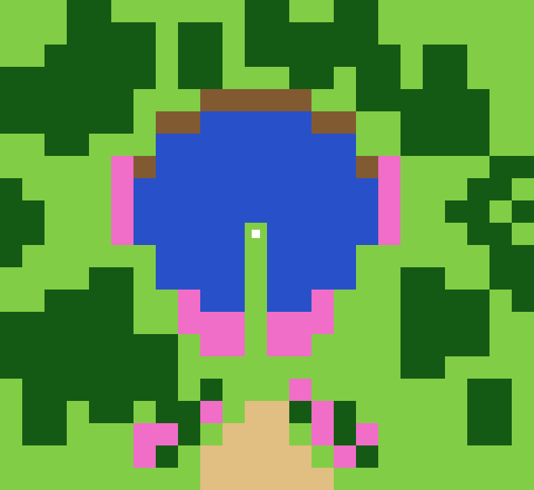

# Aurhea's Fountain: roles derived from the old map (M3b)

`derive_roles.py` reads ONLY the map crop (columns 8-391, rows 8-359 of `../../old/aurheas_fountain.png`, 384 x 352 px; the script asserts that black surrounds it and that the 21 colours of the crop are the known ones) and writes the PNGs the built-in source `aurhea` uses. Nothing below the map in the old PNG is read or copied into any file here.
`python3 derive_roles.py [--check] [--overlay PNG]` (numpy, scipy, Pillow; deterministic; the counts below are asserted in the script). `node tools/test_aurhea_roles.js` runs the PNGs through the viewer's own path.

## The grid is LEARNED, not written
For each of the 16 x 16 offsets the script counts the DISTINCT 16 x 16 blocks among the whole tiles (a tile map repeats its tiles; a misaligned grid finds almost no twin). Asserts: best < 0.5 x median and second best >= 1.5 x best.

| | offset (x, y) | distinct blocks / whole tiles |
|---|---|---|
| best (chosen) | (0, 0) | 0.161 (85 of 528: 24 x 22 tiles, no strips) |
| second best | (0, 1) | 0.286 |
| median of the 256 | | 0.478 |
| the grid of the lake contour alone | (8, 14) | 0.458 (wrong: the contour of the lake is drawn in sub-tile pieces) |

INFO, not a criterion: the 29 pink flowers (one-tile sprites) all sit inside one tile of the learned grid; with (8, 14) none does.

## Classes (old tiles, grid (0, 0), 528 tiles)
A tile is **water** when >= 40 % of its pixels are blue; else **brown** when >= 20 % (rock edge if one of its 8 neighbours is water, else dirt path); else **flower** (>= 3 % pink), **tree/bush** (>= 30 % dark green, one class, NOT blocked as in Forest), else grass.

| class | tiles |
|---|---|
| water | 75 (the pixel count of blue alone is 65.8 tiles: the lake edge tiles are partly rock) |
| rock edge (land, walkable) | 11 |
| dirt path | 16 |
| flower | 29 |
| tree / bush | 169 |
| grass | 228 |

## Zones (geometric rules, nothing painted)
Land = everything that is not water (rock edges included). PENINSULA = land tiles with water to the left AND to the right in the same row (the strip between two waters: old tiles (11, 10..13)); the others by the box of the lake (rows 5..13, centre column 11): NORTH = rows above it, SOUTH MEADOW = rows below it, WEST / EAST = the rows of the lake left / right of the centre column. The trail is NOT a zone (role `path`, its tiles are in the sector they lie in). MIN_PIECE 10 viewer tiles (as in Forest): no piece was smaller.

| raw id | zone | old tiles | px at x2 |
|---|---|---|---|
| 1 | south meadow (with the trail) | 192 | 768 |
| 2 | west shore | 64 | 256 |
| 3 | east shore | 73 | 292 |
| 4 | north shore | 120 | 480 |
| 5 | peninsula (width 1 old tile = 2 px) | 4 | 16 |

The water is in no zone. POI = the tip of the peninsula, old tile (11, 10), viewer tiles (22, 20). The viewer's table (BFS from the lowest mean, hypothesis [R]) orders them k = 1 south, 2 west, 3 east, 4 peninsula, 5 north.

## Heights [R, hypothesis, one variant; M4 calibrates against the photo]
The PNG has water 20, land 30, peninsula 60 (grey), `terraces` 1 and `subs` 5 in the example. The plan was 0 / 1 / 1.5 H; that is NOT reachable: with the pre-smoothing and the quantization by terraces (2 H per terrace, sub-terrace 0.44 H, climb limit 2 sub-terraces) no setting of `terraces` x `subs` x grey gives land 1 H and a peninsula distinctly above it (a search over 4 x 9 x 9 x 8 settings found land 0.7-1.3 H only together with a peninsula of 2.4 H or more). Measured realized heights (median, H): **water 0, land 0.308 (all four shores and the trail), peninsula 0.923** (one terrace, 5 levels; the peninsula is 2 levels above the shore, within the climb limit). Frozen in `tools/test_aurhea_roles.js`.

## What is Aurhea's and what M6 can reuse
- Aurhea's: the five colour families and the three thresholds, the geometric sector rules, the height greys, the MIN_PIECE value, the crop box.
- Reusable in M6: reading only the crop of a map and asserting its palette, the signature per tile, the grid LEARNED from the repeated blocks (with its asserts), the connected-piece / MIN_PIECE fusion, the `--check` / `--overlay` shape.
